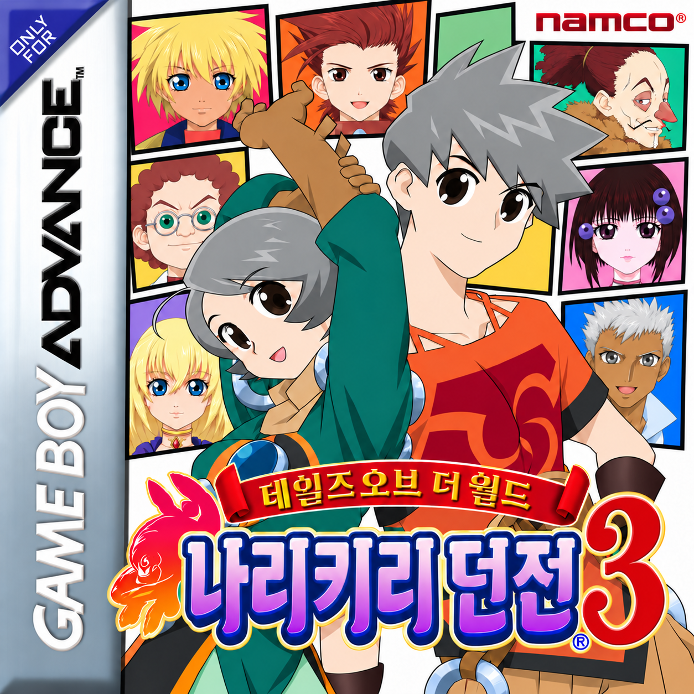

# 테일즈 오브 더 월드 나리키리 던전 3 한국어화

  

짜알님의 기존 한국어화 1.1을 계승해 Xagros가 진행하는 프로젝트입니다. 기존 제작자 표기와 크레딧, 로고 attribution, 폰트·도구 라이선스 고지를 유지합니다.

**v1.3b는 아이템·도감 설명과 안내문의 반각 공백·줄바꿈을 보완하고 목록 전환을 최적화한 16MiB 누적 BPS입니다.** 일본판 B3TJ에 한 번 적용합니다. 최종 후보의 CPU·두 PC 코어 검증은 완료했으며, 공개 패키지와 배포 검증은 진행 중입니다.

- [v1.3b 릴리스 페이지](https://github.com/GimoXagros/gba-narikiri3-kor/releases/tag/v1.3b) — 공개 준비 중
- [변경 내역](docs/RELEASE_NOTES_V1_3B.md) · [적용 안내](docs/RELEASE_README_V1_3B.md) · [검증 범위](docs/FINAL_VALIDATION_V1_3B.md)

아래는 이전 공개 버전 기록입니다.

**v1.3a는 16MiB를 유지하며 반각 공백, 대화 줄바꿈과 메뉴 가독성을 개선한 누적 BPS입니다.** 일본판 B3TJ에 한 번 적용하세요. 이번 후보의 실기 검수는 사용자 요청에 따라 배포 후 진행합니다.

- [v1.3a 패치와 안내 다운로드](https://github.com/GimoXagros/gba-narikiri3-kor/releases/tag/v1.3a)
- [변경 내역](docs/RELEASE_NOTES_V1_3A.md) · [적용 안내](docs/RELEASE_README_V1_3A.md) · [검증 범위](docs/FINAL_VALIDATION_V1_3A.md)

**v1.3은16MiB 결과를 만드는 누적 BPS입니다.** 맵 목록·지역명·갈아입기 표시와 메뉴 가독성을 수정하고 기존 번역·표기·성능 최적화를 유지합니다. 일본판 B3TJ 원본에 한 번 적용하세요. 전체 게임·모든 분기 또는 모든 기종 호환을 보증하지 않습니다.

- [v1.3 패치와 안내 다운로드](https://github.com/GimoXagros/gba-narikiri3-kor/releases/tag/v1.3)
- [v1.3 릴리스 노트](docs/RELEASE_NOTES_V1_3.md)
- [적용 안내](docs/RELEASE_README_V1_3.md) · [확인 범위](docs/FINAL_VALIDATION_V1_3.md) · [사용자 검수 기록](docs/HARDWARE_ACCEPTANCE_V1_3.md)
- [개발 및 재현 안내](docs/BUILDING.md)

2026-10-11 사용자는 비공개 검수05의 후속 회신에서 추가 문제 없음과 GitHub 업데이트를 승인했습니다. 기기·로더 버전과 개별 항목 결과는 이번 회신에 다시 제시되지 않아 UNKNOWN으로 기록합니다. 이전 OLD 2DS 환경의 진행 보고와 새 후보의 종합 회신을 구분합니다. 아래 v1.2 자료는 이전 공개 버전 기록입니다.

**v1.2는 번역과 표기를 보완한 일반 릴리스입니다. 100% 완성, 모든 분기 완주 또는 전편 무오류를 보증하지 않습니다.**

대사 용어 및 고유명사 표기, 아이템과 몬스터 도감의 속성 표기를 보완했습니다. 기존 사용자가 지정한 로이드의 말버릇 「요의 문」은 해당 대사에 유지했습니다. [v1.2 릴리스 노트](docs/RELEASE_NOTES_V1_2.md)에서 수정과 확인 범위를 설명합니다.

- [v1.2 패치와 안내 다운로드](https://github.com/GimoXagros/gba-narikiri3-kor/releases/tag/v1.2)
- [v1.2 변경 내역](CHANGELOG.md)
- [제작자와 출처](CREDITS.md)
- [개발 및 재현 안내](docs/BUILDING.md)
- [이전 v1.1a 검토용 프리릴리즈](https://github.com/GimoXagros/gba-narikiri3-kor/releases/tag/v1.1a)

패치는 일본판 B3TJ 원본에 적용하는 누적 BPS입니다. 기존 한국어 ROM에 적용하지 마세요. ROM·BIOS·개인 세이브와 에뮬레이터 실행 파일은 배포하지 않습니다. 기존 저장을 사용하기 전 별도 복사본을 백업하세요. 사용자가 OLD 2DS + DSPico + GBARunner3에서 기존 저장을 이어 스탭롤까지 진행했다고 보고했습니다. 이는 새 게임, 전 분기 또는 다른 기기의 호환성 검증을 뜻하지 않습니다.

로고는 Xagros가 2026-09-13 제공한 교체 원본이며 변형 없이 사용합니다. 게임과 원본 도안의 권리는 각 권리자에게 있습니다.
